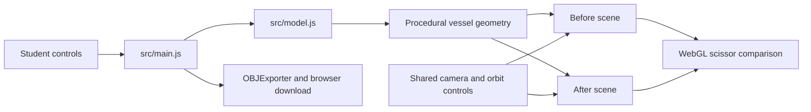

# Architecture

## System overview

Form Lab is a static, browser-only application. Vite bundles JavaScript and Three.js into `dist/`. GitHub Pages or another static host serves those files. No application backend or database exists.

## Files and responsibilities

| File | Responsibility |
| --- | --- |
| `index.html` | App entry, metadata, favicon |
| `src/main.js` | UI, technique content, scene setup, interaction state, OBJ export |
| `src/model.js` | Presets, keyword routing, lathed mesh generation, triangle counts |
| `src/style.css` | Responsive layout, visual theme, focus styles, reduced motion |
| `vite.config.js` | Relative build paths for static project hosting |
| `tests/model.test.js` | Deterministic geometry and prompt behavior |
| `tests/browser/demo.spec.js` | Browser journeys, export, mobile, fallback |
| `.github/workflows/deploy.yml` | Checks, static build, Pages deployment |

## Rendering and geometry

A lathed outer profile continues over a rim into the vessel interior. Deterministic radial modulation adds fluting or twisting; a sinusoidal offset illustrates a noisy surface. The detail control changes angular and profile resolution.

Two scenes use a shared perspective camera and OrbitControls. Each frame renders a left and right scissor rectangle into one canvas. This aligns the comparison while supporting independent materials and geometry. A ResizeObserver updates renderer dimensions and camera aspect ratio. Device pixel ratio is capped at two. Replaced geometry and materials are disposed to avoid GPU memory growth.

A hemisphere light and two directional lights illuminate the mesh. A grid and circular plinth provide spatial reference. Chrome uses a metallic material without environment-map reflections; it is a stylized material concept.

## State and interaction

Transient module state tracks the selected technique, preset, detail, and rotation. DOM controls store comparison position and wireframe state. No state is persisted or transmitted. Prompts map known keywords to three presets; unsupported prompts explicitly disclose the fallback. OBJ export serializes only the current assisted mesh and triggers a local file download.

## Educational boundary

The three research references demonstrate genuine learned techniques. This application's before/after views are hand-designed analogies, not reproduced papers or measured outputs. In particular, a coarse mesh is an illustration of a modeling stage, not a limitation of traditional software. PointCleanNet operates on point clouds; this demo uses meshes. Material parameters here are not diffusion-generated texture maps.

## Deployment and privacy

`npm run build` emits static assets. The Pages workflow builds from `main`, verifies behavior, uploads the output, and deploys with minimal Pages permissions. PRs validate without publishing. The interface uses fallback system fonts and has no runtime external asset requests. No analytics, tokens, accounts, uploads, or AI provider calls are used.

## Future extensions

A genuine inference version would need a separate provider integration, protected server-side credentials, asynchronous job handling, clear cost/latency reporting, and provenance tracking. Keep that scope distinct from this offline concept demo.
